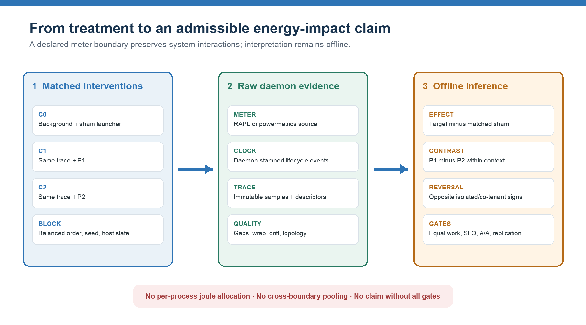
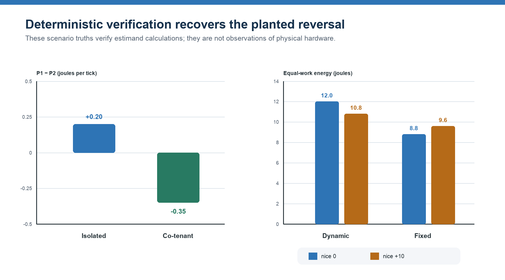
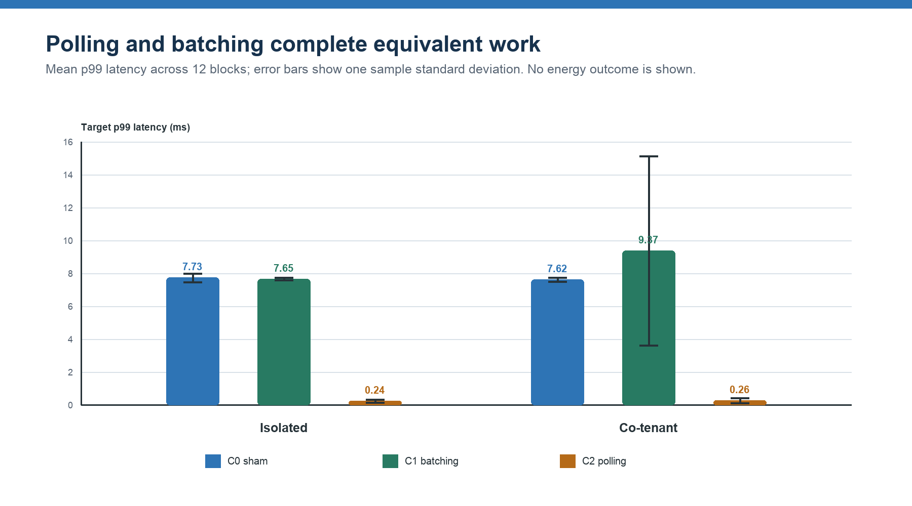

# Can Program Energy Rankings Reverse Under Co-tenancy?

## A Protocol-First Causal Study Design and Preliminary Framework Verification with Wattch

**Chakib Belgaid** 
Wattch Project 
Research preprint / Stage 1-style preregistration draft 
19 July 2026

> **Evidence status.** This manuscript reports deterministic implementation verification and a workload-admissibility pilot. It does not report a real-hardware energy effect and therefore does not claim that the proposed ranking reversal has been empirically demonstrated.

## Abstract

Software-energy studies commonly compare program variants on an otherwise quiet machine. That design is useful for repeatability, but it does not identify the total system-energy consequence of introducing a program into a production context where other workloads share caches, memory bandwidth, scheduler capacity, thermal headroom, and package power states. We hypothesize that two functionally equivalent programs can reverse their measured energy ordering between isolated and co-tenanted execution. We further hypothesize that such a reversal can arise when program priority, duration, and wakeup behavior move the processor across frequency or idle-state transitions.

We define a conditional incremental effect at an explicit meter boundary rather than a process-private energy allocation. For a daemon source boundary M, background B, policy pi, and horizon H, the estimand is the energy observed with program P minus the energy observed under a matched sham control. Wattch implements this design through a privileged raw-acquisition daemon, compact versioned traces, daemon-stamped events, boundary declarations, randomized C0/C1/C2 blocks, fixed-horizon and equal-work estimands, quality and calibration gates, and offline causal and counterfactual analysis.

We verify the estimand calculations and fault observability against six deterministic scenarios with planted truths. Wattch recovers an isolated P1-minus-P2 contrast of +0.20 joules per tick and a co-tenanted contrast of -0.35 joules per tick, detects the intended ranking reversal, reproduces an additive null, shows that a low-priority energy advantage disappears under fixed frequency, and exposes timing, carryover, wrap, gap, disappearance, drift, and aliasing failures. A separate 72-trial polling-versus-batching pilot confirms byte-identical program outputs, complete work, zero final backlog, balanced arm positions, and distinct wait behavior. The pilot has no real energy outcome because the available Apple `powermetrics` backend required a privileged daemon that could not be started non-interactively. The current evidence therefore verifies implementation behavior and workload admissibility, not the physical hypothesis. We conclude with a preregistration-ready Intel/Linux RAPL protocol capable of confirming or refuting the proposed effect.

**Keywords:** software energy, causal inference, co-tenancy, workload interference, RAPL, powermetrics, DVFS, C-states, reproducible systems experiments

## 1. Introduction

The statement “program P1 consumes more energy than program P2” hides a boundary and a context. A RAPL package counter does not identify joules privately owned by a process; it records an accumulated package-domain quantity while the operating system and every runnable task influence the same hardware. Apple `powermetrics` similarly exposes platform-specific subsystem estimates rather than a transferable whole-machine electrical measurement. Even when P1 and P2 perform identical work, they may perturb other workloads through shared caches, memory bandwidth, scheduling, wakeups, temperature, throttling, and package-wide frequency decisions.

Prior work already shows that energy accounting is non-additive and context dependent. Dong, Lan, and Zhong formalize marginal energy as E(N) minus E(N without i) within a cooperative game and show why conventional allocation policies can diverge sharply [1]. Liu et al. observe that the same task and input can have different measured energy under different co-runners [2]. Studies of cloud consolidation and application co-location report workload-dependent, nonlinear changes in execution time and energy efficiency [6-9]. The novelty sought here is therefore not the claim that co-location matters, nor the invention of a marginal contrast. It is a prospectively specified causal test of whether the ordering of two equivalent programs reverses across isolated and production-like contexts, while retaining an explicit hardware boundary and separately intervening on the proposed power-state mechanism.

This paper makes four contributions.

1. It defines program impact as a conditional incremental effect on a declared daemon measurement boundary, without claiming per-process ownership or additivity.
2. It specifies matched, randomized C0/C1/C2 experiments that jointly enforce output equivalence, fixed-horizon and equal-work agreement, service-level validity, independent-day replication, and A/A-derived meaningful-effect thresholds.
3. It separates the total energy effect from the proposed C/P-state mechanism and from a later background-only counterfactual model.
4. It presents deterministic verification that the Wattch implementation recovers planted reversals and exposes planted confounding and acquisition failures, while explicitly withholding any real-hardware conclusion.

The research question is intentionally falsifiable: under a fixed meter boundary, can the isolated P1/P2 ordering differ in sign from the matched co-tenanted ordering by more than calibrated uncertainty, without unfinished work or service degradation?

## 2. Hypothesis and estimands

### 2.1 Conditional system impact

Let Y_M(P, B, pi, H) be energy accumulated at measurement boundary M over horizon H when target program P runs under background workload B and host policy pi. Let the empty target denote a sham launcher that preserves the experimental lifecycle and offered demand but does not perform P's computation. We define

$$
tau_P(B, pi, H, M) = Y_M(P, B, pi, H) - Y_M(empty, B, pi, H).
$$

This is a last-marginal, conditional effect. It is not “the joules consumed by P,” it need not be portable to a different host or meter boundary, and the effects of multiple programs need not sum to total machine energy. This distinction avoids the budget-balance question raised by cooperative-game energy accounting [1].

### 2.2 Ranking reversal

For functionally equivalent programs P1 and P2, define the within-context contrast

$$
D(B) = tau_{P1}(B, pi, H, M) - tau_{P2}(B, pi, H, M).
$$

A context-dependent ranking reversal is present when the prespecified isolated and co-tenanted contrasts have opposite signs. The motivating direction is

$$
D(idle) > 0 \quad and \quad D(B) < 0,
$$

but the reverse direction is equally valid. A sign change is scientifically meaningful only when both point estimates exceed their A/A-derived meaningful-effect thresholds and their two-sided 95% intervals exclude zero.

### 2.3 Two horizons

We use two complementary estimands.

**Fixed-horizon energy** integrates the same launch-to-tail interval for C0, C1, and C2. It captures effects on the selected domain even when P changes the activity of co-tenants. The horizon is invalid if the arms differ by more than the prespecified timing tolerance.

**Equal-work energy** follows batch programs until identical work completes and the system recovers. Services receive an identical open-loop request trace and then drain their backlog. Runtime, work, throughput, latency, backlog, recovery time, and service-level compliance are co-reported. A program is not called better if it merely defers work or rejects demand.

Agreement between the two estimands is required for the primary ranking claim. Disagreement is a result, not a nuisance to be averaged away.

## 3. Related work

### 3.1 Attribution versus causal impact

Process-level meters commonly infer a private allocation from machine-level measurements and resource counters. E-Team, PowerAPI, and process-level virtual-machine models illustrate this attribution goal [3-5]. Such tools can be useful for accounting, but their outputs necessarily depend on an allocation model. In contrast, Wattch asks what changed at a declared hardware domain when P was introduced. It preserves the interaction with other processes rather than scheduling it away.

The distinction is especially important under sharing. Sensible Energy Accounting notes that co-runners change the energy assigned to an otherwise identical task [2]. Cooperative-game accounting formalizes non-additivity and the exact marginal contrast used here, but evaluates it as an allocation policy [1]. Wattch uses the contrast as a causal estimand and never requires all program impacts to reconcile to one budget.

### 3.2 Co-location and shared-resource interference

Energy-aware consolidation studies show that execution time, resource use, and energy are not additive under co-location [6]. Resource-conscious scheduling and HPC node modeling connect application pairing, cache and memory contention, P-states, performance, and energy [7,8]. Virtualized-cloud experiments find a nonlinear association between interference and lost energy efficiency [9]. Heracles demonstrates that a co-runner can create package-level power interference that reduces another workload's frequency, in addition to cache, DRAM, network, and scheduler interference [10]. These results make ranking reversal plausible, but they do not directly establish Wattch's matched isolated-versus-background sign criterion.

### 3.3 Power-state mechanisms

The relevant mechanism is not universally “slow is green.” DVFS can reduce instantaneous CPU power while extending the period during which memory and other components remain active [11]. Race-to-idle can win when deep idle is efficient, while pacing can win on other system/application combinations [12,13]. PowerNap and measured C-state wakeup latencies show why burst shape, idle gaps, and transition cost matter [14,15]. Online services can present gaps too short for idle-state policies, while controlled request batching can change the energy/latency trade-off [25,26]. Temperature-dependent leakage adds history dependence, motivating washout and initial-temperature blocks [16]. We therefore treat low-priority execution as a testable regime and require an intervention on frequency or deep-idle availability before making a mechanism claim.

### 3.4 Measurement validity

RAPL enables fine-grained energy studies but has domain, cadence, wrap, timing, generation, and platform-specific accuracy constraints [17-20]. Frequent polling can itself alter idle-state residency, so measurement overhead is part of the treatment unless calibrated [20]. Comparisons of AC, DC, IPMI, and model-based instruments further show that boundary, temporal resolution, and signal quality are inseparable from the claim [29]. Official Linux powercap documentation represents RAPL as a hierarchy; parent and child domains may overlap and must not be blindly summed [27]. Apple describes subsystem estimates, C-state and frequency distributions, and wakeup “prime mover” effects, while warning against treating its process energy-impact proxy as precise cross-machine energy [28]. Wattch consequently freezes one boundary, preserves evidence class, and makes calibration and topology part of claim eligibility.

### 3.5 Experimental rigor and counterfactual prediction

Systems measurements are sensitive to layout, order, thermal history, and uncontrolled state [21]. Rotated round-robin validation improves comparability by exposing variants to similar time-varying host states [22]. Hierarchical repetition and uncertainty analysis are needed because telemetry rows are not independent experimental units [23]. Wattch therefore randomizes balanced triples, blocks by host state, and splits models by complete runs rather than rows. Its later state-space counterfactual follows the general logic of predicting a no-intervention trajectory [24], but randomization remains the source of causal ground truth.

## 4. Wattch study framework

### 4.1 Raw daemon boundary

All empirical power and energy evidence enters through `wattch-powerd`. The daemon lists and describes sources, reads raw values, timestamps samples, assigns sequence numbers, batches samples, and records benchmark events. It does not integrate power, subtract baselines, allocate energy to processes, compute effect sizes, train models, or publish claims. Those operations are offline.

Protocol v0.2 adds a daemon-wide `clock_instance_id`, client `RecordEvent` messages with acknowledgements, and activated `EventBatch` frames while preserving the compact v0.1 `RawSample` shape. Offline readers retain v0.1 raw-trace readability. Source descriptors carry stable identity, backend, kind, unit, temporality, evidence class, clock domain, sampling mode, source path, and optional topology parent.

### 4.2 Measurement boundaries

Each experiment declares a `MeasurementBoundary` containing the backend, primary source UIDs, aggregation rule, evidence classes, and required topology. Comparability requires all of these to match.

- RAPL package supports an incremental CPU-package claim.
- RAPL PSys, where exposed, supports an incremental platform-domain claim.
- `powermetrics` CPU, GPU, and ANE support measured compute-domain estimates with their original evidence class.
- Whole-machine electrical energy is unavailable unless a future daemon backend exposes that physical boundary.

Nested package/core/DRAM counters are never summed. Multiple `powermetrics` domains may be summed offline only when descriptors prove disjointness. Cross-backend replications compare direction and standardized effect size rather than pooling raw joules.

### 4.3 Trial artifacts and evidence chain

Confirmatory trials produced by the full runner are designed to store `trial.json`, `manifest.json`, `sources.json`, `raw.trace.wch`, `events.trace.wch`, `quality.json`, and `checksums.json`. Workload sidecars record completed work, output digest, offered-trace digest, throughput, latency, backlog, and SLO status. Offline outputs (`features.parquet`, `predictions.jsonl`, `claims.json`, and `report.md`) are separate from immutable raw evidence. The preliminary pilot used a deliberately lighter sidecar-only artifact set and is not claim eligible.

Positive claim publication reopens the checksummed trials and recomputes acceptance. It requires exact arm/program identity, one C0/C1/C2 cell per block, matched boundaries and topology, accepted quality, sealed calibration and preregistration, equivalent P1/P2 outputs, complete work, valid SLOs, placebo equivalence, independent-day replication, and matched estimand conclusions. Manually constructed hashes or all-true booleans cannot authorize a positive claim.

**Figure 1.** Wattch preserves raw daemon evidence and performs all interpretation offline. The estimand compares a target arm with a matched sham within the same background, then compares P1 and P2 across contexts.

## 5. Confirmatory experimental design

### 5.1 Arms and randomization

Each matched block contains:

- C0: background B plus the sham launcher;
- C1: the identical B trace plus P1;
- C2: the identical B trace plus P2.

Inputs, arrival traces, seeds, affinity, resource limits, cache regime, and background command are frozen. The order is randomized through position-balanced triples. Within one compatible host and meter boundary, blocks span day, cache regime, initial temperature, and background context. Each additional machine is analyzed as a separate replication stratum. The primary physical case is polling versus batching; CPU-bound batch, memory-bound batch, open-loop service, and mixed service/batch contexts are secondary generalization regimes.

### 5.2 Calibration and sample size

For each backend and primary source, calibration measures update cadence, resolution, counter wrap, timestamp jitter, missingness, and collection overhead under idle, fixed-load, and A/A conditions. Candidate phases are shifted across the native update period to expose aliasing. The selected interval must have less than 1% overhead, less than 0.1% missing samples, and less than the prespecified phase-sensitivity limit. These are strict inequalities. A/A uncertainty is the empirical 95th percentile of absolute paired sham differences.

A discarded pilot contains 12 matched blocks per primary regime. Thermal, backlog, and state-recovery diagnostics determine washout and tail horizons; the paired block-level variance determines the confirmatory number of blocks for 90% power. Effects use the mean of within-block differences and a two-sided 95% Student-t interval. A scheduled missing, duplicate, failed-quality, incomplete-work, output-invalid, or service-invalid cell makes its entire matched block ineligible; cells are never silently dropped after outcomes are seen. The primary sign-reversal test is evaluated separately for fixed-horizon and equal-work estimands. Mechanism and generalization regimes are secondary; if multiple backgrounds are promoted to co-primary status, Holm correction will control their familywise error. The meaningful threshold is

$$
Delta_{min} = max(0.05 \times mean(C0\ energy),\ 2 \times A/A\ uncertainty).
$$

Pilot effects are never reused as confirmatory evidence.

### 5.3 Power-state mechanism test

Priority is independently randomized between nice 0 and +10. The transition-adjacent workload is repeated under normal dynamic management and fixed non-turbo frequency; restricted deep-idle states form a separate block. Let D_dynamic and D_fixed be the matched P1-minus-P2 contrasts. The energy attenuation estimand is

$$
delta_{DiD} = D_{dynamic} - D_{fixed}.
$$

Frequency/P-state, C-state residency, wakeups, utilization, temperature, and throttling observed after launch are mechanism outcomes, not adjustment variables. A positive mechanism claim additionally requires a sealed preregistration naming the raw mechanism source UIDs and a directionally consistent attenuation. Energy attenuation alone is insufficient.

### 5.4 Counterfactual model

After randomized causal ground truth exists, Wattch fits a per-host dynamic linear/state-space model only on C0 episodes. Inputs are pre-launch telemetry, host configuration, initial backlog, replay seed, and exogenous offered demand. Treatment-period frequency, C-states, wakeups, utilization, runtime, throughput, and backlog are excluded because they are effects of P. The model emits the predicted no-program path, integrated counterfactual energy, uncertainty interval, model identity, held-out control metrics, and an out-of-distribution abstention state. Splits are by complete run, seed, day, workload family, and machine.

## 6. Preliminary implementation verification

### 6.1 Environment and evidence classes

The preliminary run was executed on 19 July 2026 on an Apple M5 MacBook Pro running macOS 26.5.2. The machine exposes `/usr/bin/powermetrics`, but both direct invocation and `wattch-powerd --backend apple-powermetrics` require superuser privileges. Non-interactive sudo was unavailable. Linux RAPL is inapplicable on this host. Consequently:

- deterministic testd outcomes are `DETERMINISTIC_METHODOLOGY_VALIDATION`;
- workload observations are `WORKLOAD_ADMISSIBILITY_ONLY`;
- no result is `EMPIRICAL_METER_EVIDENCE`.

### 6.2 Deterministic scenarios

The experiment driver executed each scenario through `wattch-testd --dry-run`, parsed the emitted raw batches, computed window deltas outside the daemon, and compared them with test-only truth files. All six cases passed.

| Case | Observed result | Methodological implication |
|---|---:|---|
| Additive null | P1: 0.40; P2: 0.25 J/tick in both contexts | No false reversal under additive behavior |
| Interference reversal | P1-P2: +0.20 isolated; -0.35 J/tick with B | Correct sign-reversal recovery |
| Low-priority DVFS | Dynamic: 12.0 vs 10.8 J; fixed: 8.8 vs 9.6 J | Intervention removes/reverses planted advantage |
| Treatment timing | Naive difference: 4.0 J; both increments: 2.0 J | Matched sham removes timing confounding |
| Carryover | Immediate-rested bias: -2.4 J; deep idle: 10% vs 90% | Washout and initial-state blocking are necessary |
| Quality faults | Wrap, ticks 3-4 gap, disappearance after tick 5, drift, alias | Raw failures remain detectable offline |

**Figure 2.** Left: the planted P1/P2 ordering reverses between isolated and co-tenanted contexts. Right: low priority saves energy only under the planted dynamic-frequency regime; fixing frequency reverses the comparison. These are deterministic truths, not hardware observations.

A live protocol smoke capture additionally recorded 19 batches and 76 samples from four sources over approximately 250 ms, with monotonic sequences and zero sample gaps. This verifies socket acquisition plus artifact inspection and readability for the scenario; it does not constitute a full replay analysis or convert synthetic readings into empirical evidence.

### 6.3 Polling-versus-batching workload pilot

The workload pilot used 12 position-balanced blocks in each of two contexts, for 72 target trials in total. Each target completed 384 identical work items generated from a fixed per-block seed. Within each co-tenanted matched block, all three arms also completed the same 768-item background trace; seeds varied across blocks. P1 batching and P2 polling produced one common stdout digest across all runs. Every target and background reported complete work, zero final backlog, a valid arrival trace, and latency below a 1000 ms pilot health threshold. That permissive threshold checks harness failure only and is not yet an application-justified SLO.

| Context | Arm | Mean runtime (s) | Mean p99 latency (ms) | Interpretation |
|---|---|---:|---:|---|
| Isolated | C0 sham | 0.19345 | 7.733 | Arrival-harness control |
| Isolated | C1 batching | 0.19227 | 7.654 | Blocking, 16-item dispatch batches |
| Isolated | C2 polling | 0.19332 | 0.238 | Busy nonblocking reads |
| Co-tenant | C0 sham | 0.19325 | 7.620 | Matched background control |
| Co-tenant | C1 batching | 0.19323 | 9.374 | One latency outlier; health threshold retained |
| Co-tenant | C2 polling | 0.19318 | 0.263 | Busy nonblocking reads |

Polling performed at least 205,883 empty reads per trial, while batching performed none. Thus the variants are functionally equivalent but show different wait behavior designed to perturb scheduler and wakeup demand, making them a reasonable first physical case. Scheduler and wakeup telemetry was not collected in this pilot. The pilot cannot say which consumes more energy or whether a ranking reverses.

**Figure 3.** Mean p99 target latency in the workload-admissibility pilot. Error bars show one sample standard deviation across 12 matched blocks. No energy variable is plotted or implied.

## 7. Interpretation

The preliminary evidence answers an engineering question, not the physical research question. Wattch's fixture-specific checks recover a planted ranking reversal from raw cumulative evidence, preserve the null when effects are additive, expose confounding that naive comparisons would misread, and verify that the proposed P1/P2 case performs identical work. These checks verify estimand calculations and fault observability before privileged hardware trials begin; they are not a generic end-to-end validation of every confirmatory claim gate.

It does not establish that real polling and batching reverse under co-tenancy. The deterministic scenarios were constructed to contain that outcome, and the workload pilot had no real meter. Treating either as confirmation would be circular. The next scientifically valid result must come from calibrated, daemon-backed RAPL or `powermetrics` trials with a frozen boundary.

The most defensible expected contribution is also narrower than “the literature assumes energy is intrinsic.” Prior literature explicitly recognizes non-additivity, co-runner dependence, and marginal effects [1,2,6-9]. A successful Wattch study would add a direct, prospectively registered ordering-reversal demonstration, paired fixed/equal-work evidence, and an intervention on the power-state mechanism. A null result would still be useful: it would bound the phenomenon for the studied platform, meter, programs, and backgrounds.

## 8. Threats to validity

**Construct validity.** RAPL package, PSys, and `powermetrics` subsystem estimates have different physical meanings. All claims remain boundary specific. Neither package RAPL nor `powermetrics` compute-domain estimates are silently renamed whole-machine electrical energy.

**Internal validity.** Thermal history, cache state, background phase, frequency policy, meter cadence, and launch-marker delay can bias comparisons. Balanced matched triples, washout, initial-state blocks, daemon-stamped markers, and sham subtraction mitigate but do not eliminate these risks.

**Interference and consistency.** In this setting, interference is the treatment pathway of interest. Traditional isolation would remove the phenomenon. Instead, the study controls the background trace and requires treatment consistency: each arm must receive the same offered demand and resource policy, and the background command must be identical.

**Measurement reactivity.** Sampling can itself inhibit deep C-states [20]. The no-collector versus instrumented calibration and strict overhead threshold are therefore essential. A testd success says nothing about a real meter's update cadence or reactivity.

**Statistical validity.** Telemetry rows are autocorrelated and are not the unit of inference. Effects are computed per matched block; intervals operate on block-level differences. Pilot selection, A/A uncertainty, placebo equivalence, independent-day replication, and the minimum block floor prevent row-level pseudo-replication.

**External validity.** Results may vary by microarchitecture, firmware, microcode, kernel, governor, scheduler, background mix, and meter boundary. Cross-machine work is a replication, not an automatic pool. `powermetrics` and RAPL results compare direction and standardized effect, not raw joules.

**Model validity.** A good background forecast does not make a causal claim. Validated counterfactual publication requires randomized causal ground truth, complete-run held-out validation, no treatment-period mediator leakage, and out-of-distribution abstention.

## 9. Falsification criteria and next experiment

The primary hypothesis is supported only if all of the following hold:

1. P1 and P2 outputs are equivalent and all required work completes.
2. Isolated and co-tenanted contrasts have opposite preregistered signs.
3. Both effects exceed the A/A-derived meaningful threshold with two-sided 95% intervals.
4. Fixed-horizon and equal-work conclusions agree.
5. Backlog, throughput, latency, recovery, and an application-justified SLO exclude deferred or degraded service.
6. Placebo effects lie fully inside the equivalence band.
7. The result replicates on at least two independent days.
8. A mechanism claim is made only if fixed-frequency or restricted-idle intervention attenuates the reversal and raw P/C-state plus wakeup outcomes change consistently.

The first empirical platform should be Intel/Linux with the RAPL package or PSys source exposed by `wattch-powerd`. The sequence is: privileged daemon deployment; source discovery and boundary freeze; idle/fixed-load/A/A calibration; 12-block discarded pilot; preregistration sealing; power-derived confirmatory size; randomized isolated and co-tenant trials; independent-day replication; and a separately blocked mechanism intervention. Apple `powermetrics` is a platform replication, not a pool with RAPL.

## 10. Conclusion

Program energy is better treated as a conditional system effect than as an intrinsic scalar attached to a process. Shared resources, scheduler behavior, power states, and thermal history make a ranking reversal plausible, but plausibility is not evidence. Wattch provides a protocol-first path from raw daemon telemetry to a falsifiable matched experiment without pretending to isolate process-private joules.

The preliminary experiments show that the implementation recognizes planted reversals, preserves planted null behavior, catches several confounders and acquisition faults, and supports a functionally equivalent polling-versus-batching case. They do not validate the physical hypothesis. The decisive contribution now depends on sealing and running the preregistration-ready, calibrated real-meter study and publishing the result whether it is positive, null, or boundary dependent.

## Reproducibility and artifact availability

The preliminary driver is `research/system-energy-impact/experiments/run_preliminary_validation.py`. Machine-readable results are under `research/system-energy-impact/results/`. The live deterministic capture is under `results/live_protocol/deterministic-live-reversal/`. The Wattch study specification is in `docs/energy-impact-study.md`; the first workload is in `examples/workloads/polling_batching_worker.py` with its benchmark sketch in `examples/bench/polling_vs_batching.toml`.

## References

[1] M. Dong, T. Lan, and L. Zhong. “Rethink Energy Accounting with Cooperative Game Theory.” *ACM MobiCom*, 2014. https://doi.org/10.1145/2639108.2639128

[2] Q. Liu, M. Moretó, J. Abella, F. J. Cazorla, D. A. Jiménez, and M. Valero. “Sensible Energy Accounting with Abstract Metering for Multicore Systems.” *ACM TACO* 12(4), 2016. https://doi.org/10.1145/2842616

[3] T. Smejkal, M. Hähnel, T. Ilsche, M. Roitzsch, W. E. Nagel, and H. Härtig. “E-Team: Practical Energy Accounting for Multi-Core Systems.” *USENIX ATC*, 2017, pp. 589-601. https://www.usenix.org/conference/atc17/technical-sessions/presentation/smejkal

[4] M. Colmant, M. Kurpicz, P. Felber, L. Huertas, R. Rouvoy, and A. Sobe. “Process-Level Power Estimation in VM-Based Systems.” *EuroSys*, 2015. https://doi.org/10.1145/2741948.2741971

[5] G. Fieni, D. Romero Acero, P. Rust, and R. Rouvoy. “PowerAPI: A Python Framework for Building Software-Defined Power Meters.” *Journal of Open Source Software* 9(98), 2024. https://doi.org/10.21105/joss.06670

[6] S. Srikantaiah, A. Kansal, and F. Zhao. “Energy Aware Consolidation for Cloud Computing.” *USENIX HotPower*, 2008. https://www.usenix.org/event/hotpower08/tech/full_papers/srikantaiah/srikantaiah_html/main.html

[7] A. Merkel, J. Stoess, and F. Bellosa. “Resource-Conscious Scheduling for Energy Efficiency on Multicore Processors.” *EuroSys*, 2010. https://doi.org/10.1145/1755913.1755930

[8] D. Dauwe, E. Jonardi, R. D. Friese, S. Pasricha, A. A. Maciejewski, D. A. Bader, and H. J. Siegel. “HPC Node Performance and Energy Modeling with the Co-Location of Applications.” *Journal of Supercomputing* 72, 2016, pp. 4771-4809. https://doi.org/10.1007/s11227-016-1783-y

[9] R. Yang, I. S. Moreno, J. Xu, and T. Wo. “An Analysis of Performance Interference Effects on Energy-Efficiency of Virtualized Cloud Environments.” *IEEE CloudCom*, 2013. https://doi.org/10.1109/CLOUDCOM.2013.22

[10] D. Lo, L. Cheng, R. Govindaraju, P. Ranganathan, and C. Kozyrakis. “Heracles: Improving Resource Efficiency at Scale.” *ISCA*, 2015. https://doi.org/10.1145/2749469.2749475

[11] G. Dhiman, K. K. Pusukuri, and T. Š. Rosing. “Analysis of Dynamic Voltage Scaling for System Level Energy Management.” *USENIX HotPower*, 2008. https://www.usenix.org/conference/hotpower-08/analysis-dynamic-voltage-scaling-system-level-energy-management

[12] É. Le Sueur and G. Heiser. “Dynamic Voltage and Frequency Scaling: The Laws of Diminishing Returns.” *USENIX HotPower*, 2010. https://www.usenix.org/legacy/event/hotpower/tech/full_papers/LeSueur.pdf

[13] D. H. K. Kim, C. Imes, and H. Hoffmann. “Racing and Pacing to Idle: Theoretical and Empirical Analysis of Energy Optimization Heuristics.” *IEEE CPSNA*, 2015. https://doi.org/10.1109/CPSNA.2015.23

[14] D. Meisner, B. T. Gold, and T. F. Wenisch. “PowerNap: Eliminating Server Idle Power.” *ASPLOS*, 2009. https://doi.org/10.1145/1508244.1508269

[15] R. Schöne, D. Molka, and M. Werner. “Wake-up Latencies for Processor Idle States on Current x86 Processors.” *Computer Science - Research and Development* 30, 2015. https://doi.org/10.1007/s00450-014-0270-z

[16] M. Zapater, O. Tuncer, J. L. Ayala, J. M. Moya, K. Vaidyanathan, K. Gross, and A. K. Coskun. “Leakage-Aware Cooling Management for Improving Server Energy Efficiency.” *IEEE TPDS* 26(10), 2015. https://doi.org/10.1109/TPDS.2014.2361519

[17] M. Hähnel, B. Döbel, M. Völp, and H. Härtig. “Measuring Energy Consumption for Short Code Paths Using RAPL.” *ACM SIGMETRICS Performance Evaluation Review* 40(3), 2012. https://doi.org/10.1145/2425248.2425252

[18] K. N. Khan, M. Hirki, T. Niemi, J. K. Nurminen, and Z. Ou. “RAPL in Action: Experiences in Using RAPL for Power Measurements.” *ACM TOMPECS* 3(2), 2018. https://doi.org/10.1145/3177754

[19] S. Desrochers, C. Paradis, and V. M. Weaver. “A Validation of DRAM RAPL Power Measurements.” *MEMSYS*, 2016. https://doi.org/10.1145/2989081.2989088

[20] G. Raffin and D. Trystram. “Dissecting the Software-Based Measurement of CPU Energy Consumption: A Comparative Analysis.” *IEEE TPDS* 36(1), 2025, pp. 96-107. https://doi.org/10.1109/TPDS.2024.3492336

[21] T. Mytkowicz, A. Diwan, M. Hauswirth, and P. F. Sweeney. “Producing Wrong Data Without Doing Anything Obviously Wrong!” *ASPLOS*, 2009. https://doi.org/10.1145/1508244.1508275

[22] M. A. Bokhari, B. Alexander, and M. Wagner. “Towards Rigorous Validation of Energy Optimisation Experiments.” *GECCO*, 2020. https://doi.org/10.1145/3377930.3390245

[23] T. Kalibera and R. E. Jones. “Rigorous Benchmarking in Reasonable Time.” *ISMM '13*, 2013, pp. 63-74. https://doi.org/10.1145/2464157.2464160

[24] K. H. Brodersen, F. Gallusser, J. Koehler, N. Remy, and S. L. Scott. “Inferring Causal Impact Using Bayesian Structural Time-Series Models.” *Annals of Applied Statistics* 9(1), 2015. https://doi.org/10.1214/14-AOAS788

[25] D. Meisner, C. M. Sadler, L. A. Barroso, W.-D. Weber, and T. F. Wenisch. “Power Management of Online Data-Intensive Services.” *ISCA*, 2011. https://doi.org/10.1145/2000064.2000103

[26] E. N. Elnozahy, M. Kistler, and R. Rajamony. “Energy Conservation Policies for Web Servers.” *USITS*, 2003. https://www.usenix.org/conference/usits-03/energy-conservation-policies-web-servers

[27] Linux Kernel Documentation. “Power Capping Framework.” https://www.kernel.org/doc/html/latest/power/powercap/powercap.html

[28] Apple. “powermetrics(1) Manual Page.” https://keith.github.io/xcode-man-pages/powermetrics.1.html

[29] D. Hackenberg, T. Ilsche, R. Schöne, D. Molka, M. Schmidt, and W. E. Nagel. “Power Measurement Techniques on Standard Compute Nodes: A Quantitative Comparison.” *IEEE ISPASS*, 2013. https://doi.org/10.1109/ISPASS.2013.6557170
